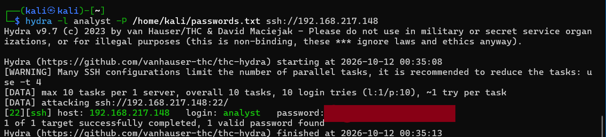
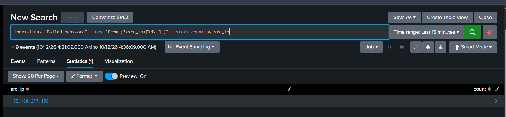
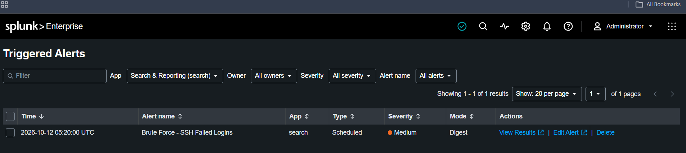

# Detection: SSH Brute Force (Password Guessing)

**MITRE ATT&CK:** T1110.001 - Brute Force: Password Guessing

## Scenario
I simulated an external attacker trying to break into my Linux server over SSH by
guessing the password for a known account, then built a Splunk detection to catch it.

## Attack Simulation
I used Hydra from my Kali VM to run a password list against the `analyst` account
on my Splunk server over SSH. The list included common weak passwords along with
the account's actual password, so the attack would succeed rather than just
generate noise, similar to how real intrusions often come from password reuse
rather than anything exotic.

## Log Source
- Index: `linux`
- Sourcetype: `linux_secure`
- File: `/var/log/auth.log`

## Detection Logic

\`\`\`spl
index=linux "Failed password" | rex "for (invalid user )?(?<user>\w+) from (?<src_ip>[\d\.]+)" | stats count by user, src_ip | where count > 3
\`\`\`

This pulls the username and source IP out of each failed SSH login, counts failures
per IP, and flags any IP with more than 3 failures. I picked 3 because a legitimate
user who mistypes a password usually gives up or gets it right within a couple of
tries. The alert runs on a 5-minute schedule, so the threshold really means "more
than 3 failed logins from one IP within 5 minutes," not 3 failures ever. That
distinction matters: a user who fails 4 times spread across 30 minutes won't
trigger this, but an automated tool hammering the account in seconds will.

## Alert
Saved as a scheduled alert that runs every 5 minutes (`earliest=-5m`, `latest=now`)
and fires when the search returns any results, since the filtering already happens
inside the SPL itself.

## Limitation
This detection catches fast, noisy brute forcing but misses a "low and slow"
attacker who deliberately spaces out login attempts, for example one attempt every
few minutes. An attacker doing that would never exceed 3 failures in any single
5-minute window, so the alert would never fire even though the attack is still
happening, just more patiently. Catching that would need a longer lookback window
or tracking cumulative failures per IP over hours instead of minutes.
