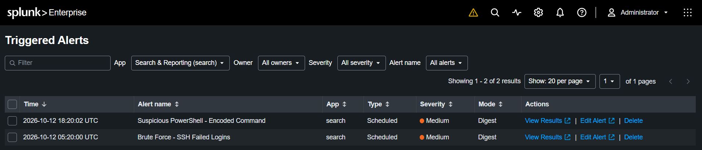

# Detection: Suspicious PowerShell - Encoded Command

**MITRE ATT&CK:** T1059.001 - Command and Scripting Interpreter: PowerShell

## Scenario
After gaining access to the Windows machine, I simulated an attacker running a
Base64-encoded PowerShell command, a common way real attackers hide what a command
actually does from anyone glancing at a log or a terminal. This builds on the
brute force attack, since a cracked password is one realistic way an attacker
would get a foothold to run commands like this in the first place.

## Attack Simulation
I ran an encoded command through `powershell.exe -enc <base64>` directly on the
Windows VM. The decoded command itself was harmless, it just printed a message,
but the pattern of invocation (`powershell.exe` launched with `-enc` and a long
encoded string) is identical in shape to how real attackers launch malicious
payloads, which is what makes it detectable regardless of what the command
actually does.

Looking at the process chain in Sysmon, the encoded `powershell.exe` process was
itself launched from another `powershell.exe` process, one PowerShell session
spawning another with an encoded command. This nested pattern is a known technique
for layering or disguising commands, and it's different from the more "textbook"
case of a document or script silently launching PowerShell with no user ever
opening a terminal.

## Log Source
- Index: `windows`
- Source: Sysmon Event ID 1 (Process Creation)
- Key fields: `CommandLine` (used to detect it), `ParentImage` (used to investigate
  what launched it)

## Detection Logic

\`\`\`spl
index=windows EventCode=1 "-enc" | table _time, Image, ParentImage, User, CommandLine
\`\`\`

Unlike the brute force rule, this doesn't use a count threshold. A single encoded
PowerShell execution is already unusual enough on its own to be worth flagging,
most legitimate admin activity doesn't need to hide its command line, so the
presence of the behavior is the signal, not its frequency.

## Alert
Saved as a scheduled alert running every 5 minutes (`earliest=-5m`, `latest=now`),
triggering when the search returns any results.

## Limitation
This detection relies on the literal text `-enc` appearing in the command line.
An attacker aware of this could use the full flag name (`-EncodedCommand`), a
different short form (`-e`), or unusual casing (`-EnC`) to avoid matching the
search exactly. A more resilient version of this detection would normalize or
account for these variants rather than matching one literal string.
