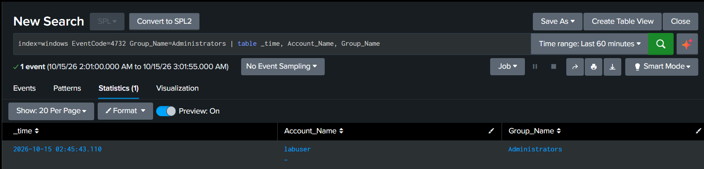
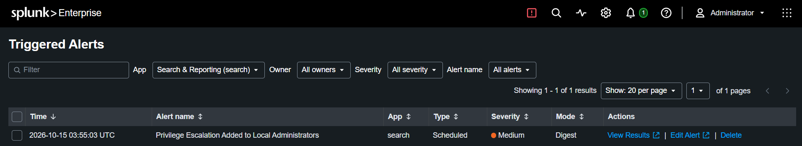

# Detection: Privilege Escalation via Local Administrators Group

**MITRE ATT&CK:** T1098 - Account Manipulation

## Scenario
Assuming an attacker already has a foothold on the machine, the next step is
usually to gain full control rather than stay limited to a regular user account.
I simulated this by creating a low-profile backdoor account and adding it to the
local Administrators group, a simple but common real-world escalation technique.

## Attack Simulation
From an elevated PowerShell session (representing an attacker who already has
some level of access), I created a new account named `svc_update`, a
service-sounding name real attackers often use so it doesn't stand out in a user
list, and then added it to the local Administrators group:

\`\`\`
net user svc_update Temp@12345 /add
net localgroup Administrators svc_update /add
\`\`\`

The first command creates the account. The second is the actual privilege
escalation step, and the one this detection targets.

## Log Source
- Index: `windows`
- Source: Windows Security log, Event ID 4732 (a member was added to a
  security-enabled local group)
- Key fields: `Account_Name` (who performed the action), `Group_Name` (which
  group the account was added to)

A quirk worth noting: in this event type, `Account_Name` is the person who made
the change, not the account that got added. The added account's name sits inside
the raw `Message` text rather than a clean field, a reminder that different
Windows event types expose data with very different levels of structure.

## Detection Logic

\`\`\`spl
index=windows EventCode=4732 Group_Name=Administrators | table _time, Account_Name, Group_Name
\`\`\`

A bare search for `EventCode=4732` isn't specific enough on its own, since
Windows generates this event any time a member is added to *any* local group,
including the ordinary, harmless case of a new account automatically being added
to the default Users group. Filtering on `Group_Name=Administrators` is what
narrows this down to the one change that actually matters: someone gaining
admin-level access.

## Alert
Saved as a scheduled alert running every 5 minutes (`earliest=-5m`,
`latest=now`), triggering when the search returns any results. No count
threshold is used, since even a single unexpected addition to Administrators is
significant enough to investigate on its own.

## Limitation
This detection only catches privilege escalation done through
`net localgroup`/group membership changes. An attacker could gain admin rights
through other means entirely, for example exploiting an unpatched vulnerability,
stealing an existing admin's credentials and logging in directly, or using a
scheduled task running as SYSTEM, none of which would generate a 4732 event at
all. This rule covers one specific technique, not privilege escalation as a
whole.

It also doesn't distinguish a malicious addition from a legitimate one. A real
IT admin adding a real employee to Administrators produces the exact same
event. Confirming which one it is would require additional context a SIEM alert
alone can't provide: checking whether the account `svc_update` matches a known,
documented service account, whether a change ticket or approval exists for it,
and whether `labuser`, the account that performed the action, is someone
actually authorized to manage group membership in the first place.
